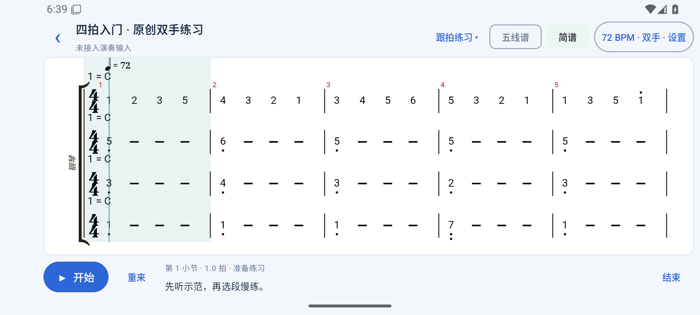

# OpenMusic

个人使用的 Android 乐器练习应用，首版以钢琴为主：导入结构化乐谱，显示五线谱或简谱，跟随节拍游标练习，并通过 USB MIDI 记录音高与起音偏差。

项目包含完整 Android 源码、Gradle Wrapper、ScoreIR 格式规范、原创样例和单元测试。开发环境为 Windows，界面兼容手机和横屏平板，最低 Android 8.0（API 26）。

## 当前功能

- **本地曲库**：直接导入 UTF-8 ScoreIR JSON，或根目录含 `score.json` 的 `.scorepack` ZIP 文件；导入时进行结构和音乐语义校验。
- **跟谱练习**：五线谱／简谱切换、拍点游标、节拍器、示范音、速度调整、左右手选择、A–B 小节循环、0–2 小节预备拍、暂停与重新开始。
- **四种练习模式**：固定速度跟拍、弹对前进、测评、示范。练习控制使用展开后的演奏小节编号，简单反复已计入。
- **USB MIDI 输入**：发现与连接 Android MIDI 设备，接收按键、松键与延音踏板消息，显示最近通信日志。
- **练习记录**：保存输入来源、速度、片段、音符匹配、漏音、额外音、提前／延后和起音误差；支持错误片段重练及 JSON 导出。
- **本地保存**：导入曲谱和已结束的练习使用原子 JSON 文件保存。界面提供示例导出、记录导出和 MIDI 日志导出。
- **测试键盘**：可在设备页或练习设置中展开，并切换八度，用于验证输入流程；记录中明确标注测试来源。

当前评分检查 **MIDI 音高与起音时刻**。按键持续时长、力度、踏板效果和演奏表现尚未纳入评分。应用通过手机／平板播放简单合成示范音，电钢琴的原声音色继续由电钢琴输出。

简谱按声部与和弦音分行，纵向对齐的数字同时演奏；全部音符保留，音线之间的休止按原时值补齐。手机横屏采用紧凑控制栏，速度、左右手和选段参数集中到「设置」，为谱面保留显示空间。

本版直接消费 **ScoreIR 0.1.0**。它是本项目定义的版本化中间格式；PDF、JPG、OCR、AI 识谱、音频转谱和原始 MusicXML／MIDI 文件导入属于后续生产端。未来转换工具按 [ScoreIR 导入契约](docs/scoreir.md) 输出即可接入。吉他、长笛等实音乐谱可以用于跟谱练习，专用指法、六线谱及麦克风识音需要后续扩展。

## 运行截图

Android 15 模拟器的实际运行画面，对应已通过构建与运行检查的功能提交 `ef3fe9c`。测试过程及结果见 [验证记录](docs/verification.md)，另有 [竖屏五线谱截图](docs/screenshots/portrait-staff.png)。



## Windows 快速开始

1. 安装 Git、[Android Studio](https://developer.android.com/studio) 和 JDK 17。Android Studio 自带的兼容 JBR 也可用于运行构建；源码字节码目标为 Java 17。
2. 在 Android Studio 的 SDK Manager 安装 **Android SDK Platform 36、Build-Tools 35.0.0、Platform-Tools**。项目使用 `compileSdk 36`、`targetSdk 35`；API 35 模拟器用于运行验证。
3. 拉取仓库，在 Android Studio 中打开仓库根目录，等待 Gradle 同步；也可使用 PowerShell：

```powershell
git clone https://github.com/wolf111108/OpenMusic.git
cd OpenMusic
powershell -ExecutionPolicy Bypass -File .\scripts\build-windows.ps1
```

构建脚本默认运行核心测试、Android 本地单元测试并生成 debug APK。指定 JDK 时：

```powershell
powershell -ExecutionPolicy Bypass -File .\scripts\build-windows.ps1 -JdkPath "C:\Program Files\Java\jdk-17"
```

APK 输出位置：

```text
app\build\outputs\apk\debug\app-debug.apk
```

把 APK 复制到手机／平板后安装，或连接已开启 USB 调试的设备执行：

```powershell
powershell -ExecutionPolicy Bypass -File .\scripts\build-windows.ps1 -Install
```

构建依赖首次需要联网下载。安装后的跟谱、示范、导入及练习数据保存都在本机完成。详细环境设置、测试命令和常见错误见 [Windows 构建说明](docs/windows-build.md)。

## 第一次练习

1. 打开「曲库」，选择内置的 **四拍入门 · 原创双手练习**；第二份 **节奏小练习 · 连音与反复** 用于检查延音、拍号与反复。
2. 选择「示范」，将速度调慢，确认节拍声、谱面与游标。
3. 通过「设备」连接电钢琴，实际按下几个琴键，确认日志中持续出现消息。
4. 返回曲谱，选择右手和较短的 A–B 片段，先用「弹对前进」熟悉音符，再用「跟拍练习」检查节奏。
5. 一轮结束后查看结果与记录；有错误小节时可直接重练包含这些小节的连续片段。

| 模式 | 行为 | 结果含义 |
|---|---|---|
| 跟拍练习 | 游标按设定速度前进，输入时显示轻量反馈 | 有输入时统计匹配与起音偏差；无输入时保存用时 |
| 弹对前进 | 当前音组匹配后前进，音组间和片段尾部的休止按速度等待；暂停后保留剩余休止 | 关注音高匹配与额外音；固定速度误差留给跟拍与测评 |
| 测评 | 按速度播放，过程中收起逐音对错反馈 | 结束后集中展示检测结果 |
| 示范 | 按所选左右手播放合成音并移动游标 | 记录用时 |

选择左右手会影响目标音和示范音；谱面保留双手，便于查看上下文。未连接输入时界面明确提示检测未启用；「弹对前进」需要 MIDI 或测试键盘输入。

切到后台或失去音频焦点时，练习自动暂停。固定速度练习在末尾保留输入匹配窗口；出现「判分收尾」时，游标停在片段终点，等待最后一组输入结算。

## 导入自己的曲谱

按 [格式规范](docs/scoreir.md) 生成 JSON，可从 [基础样例](samples/first_steps.scoreir.json) 修改。文件内 `schema_version` 当前固定为 `0.1.0`；节奏使用以四分音符为单位的分数字符串，例如 `"1/2"` 表示八分音符。

应用支持两种入口：

- `曲名.scoreir.json`：单个 UTF-8 JSON 文件，最大 2 MiB。
- `曲名.scorepack`：ZIP 容器，根目录包含 `score.json`。输入文件最大 8 MiB，解压总量最大 8 MiB，单个条目最大 2 MiB，最多 128 个条目。应用以其中的 ScoreIR 重新编译谱面和时间线。

导入器会显示错误位置或音乐语义错误。源谱读取是否正确仍需转换工具和人工校对确认。格式规范、JSON Schema 与 Kotlin 核心校验共同构成后续 AI 识谱的接口边界。

## 电钢琴与真机验证

P45 连接方案：**电钢琴 USB TO HOST（USB Type-B）→ 支持数据传输的 USB-B／USB-C 线 → Android USB-C 主机接口**；也可用 USB-A／USB-B 线加 USB-C OTG 转接。P45 自身照常供电。

本应用接收 MIDI 演奏消息。Xiaomi 15 的 Type-C 支持 OTG；REDMI K Pad 首先使用官方标注支持 HOST 数据传输的短边 USB-C 口。相关官方资料、接线与验收步骤见 [设备验证清单](docs/device-validation.md)。

**本仓库实现尚未在 P45、Xiaomi 15、REDMI K Pad 的真实组合上完成验收。** 构建与单元测试用于检查代码和纯逻辑；设备枚举、音频延迟、实际谱面布局及长时间同步需按清单验证。

## 代码入口

| 目录／文件 | 内容 |
|---|---|
| `app/.../ui/` | Compose 页面、UI 状态与用户操作契约 |
| `app/.../OpenMusicViewModel.kt` | 会话状态、四种模式、导入导出、输入处理 |
| `app/.../practice/PracticeTimeline.kt` | 速度、选段、预备拍与统一时间映射 |
| `app/.../platform/` | alphaTab 原生谱面、Android MIDI、AudioTrack 播放 |
| `app/.../data/` | 文件边界、ScoreIR 导入、本地保存 |
| `core/` | 纯 Kotlin 模型、语义校验、编译、MusicXML、评分 |
| `schemas/`、`samples/` | 版本化 JSON Schema 与原创练习谱 |

完整模块关系与后续扩展方式见 [架构说明](docs/architecture.md)。依赖与许可证信息见 [第三方声明](THIRD_PARTY_NOTICES.md)。

## 自动构建与验证

提交到 `main` 后，[GitHub Actions](https://github.com/wolf111108/OpenMusic/actions) 运行核心与导入测试、MIDI 字节流测试、实际 alphaTab 时值一致性测试、Android Lint，并生成 `OpenMusic-debug-apk` 构建产物。后续模拟器任务检查谱面加载、简谱切换、示范暂停和模拟输入，上传截图与报告。以对应提交的 Actions 结果确认远程执行状态。

仓库使用固定的 Gradle、Kotlin、Android 插件和谱面依赖版本。谱面采用官方 alphaTab 1.8.4，其中包含低音 C3 简谱八度点的修正；原生库单独锁定至支持 16 KB 对齐的 alphaSkia 3.5.147，见 [原生库兼容性记录](docs/native-compatibility.md)。构建与运行验证详情见 [验证记录](docs/verification.md)。
