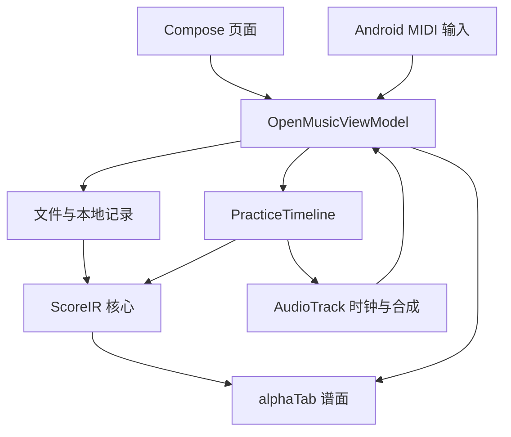

# OpenMusic 架构与开发边界

## 1. 模块划分

应用采用单 Activity、Compose UI、ViewModel 与纯 Kotlin 核心模块。Android 平台相关能力集中在 `app`，ScoreIR 语义、编译和评分位于 `core`，便于未来的转换器、桌面校对工具复用。

| 入口 | 职责 |
|---|---|
| `MainActivity` | 生命周期、系统文件选择器、创建文档导出、运行时保持屏幕唤醒 |
| `OpenMusicUiState` / `UiAction` | UI 状态投影和用户操作契约，页面通过回调驱动业务 |
| `OpenMusicViewModel` | 曲库选择、模式状态、练习轮次、输入与播放协调、记录保存 |
| `ScoreImport` | 严格 UTF-8、JSON／ZIP 容器、大小与条目检查 |
| `LocalStore` | 原子保存曲谱与会话 JSON，加载内置样例与导入曲谱 |
| `ScoreCodec` / `ScoreCompiler` | 结构和音乐语义校验、反复展开、时间图、演奏目标与 MusicXML |
| `PracticeTimeline` | A–B 片段、分手过滤、速度倍率、预备拍及时钟坐标转换 |
| `PracticeAudioFocus` | 播放前申请音频焦点，失去焦点时暂停 |
| `PracticeEvaluator` / `WaitingMatcher` | 固定速度音高／起音匹配，以及等待模式音组匹配 |
| `MidiInputController` | Android MIDI 服务、设备连接、字节流解码、原始日志 |
| `NativeAudioTransport` | 原生 PCM 合成、节拍与音符调度、音频播放位置 |
| `ScoreRenderer` | 原生 alphaTab 视图、五线谱／简谱切换、外部驱动游标 |
| `NumberedScoreAdapter` | 简谱展示副本，按声部与和弦音分行并保留全部音符和时值 |

## 2. ScoreIR 是唯一导入语义源

直接导入 JSON 或解出 `.scorepack` 根目录中的 `score.json` 后，统一进入 `ScoreCodec.parse` 和 `ScoreCompiler.compile`。包内附加的派生文件不会覆盖核心编译结果。

编译器把节奏保留为四分音符单位的精确有理数，校验音高拼写与 MIDI 编号、小节边界、声部重叠、延音线和简单反复，再生成：

- 展开后的演奏小节及其来源映射。
- 合并延音线、同一时刻同键后的目标音和音组。
- 速度图，以及曲内秒与四分音符位置的双向映射。
- 同一展开顺序的 MusicXML，用于谱面显示。

完整字段、规模限制和未来生产端接口见 [ScoreIR 0.1.0 契约](scoreir.md)。原始 PDF／JPG 和识谱服务处于该接口的上游，当前应用无需模型密钥或后端。

### 谱面展示适配

alphaTab 1.8.4 的简谱引擎只渲染每个谱表的第一个声部、每个音组的第一个音。`NumberedScoreAdapter` 使用公开模型序列化接口生成独立的展示副本，将原谱表的声部与和弦拆为按节拍对齐的单音音线，空白位置补等时值休止。延音链优先保持在同一音线，以保留和弦变位时的延音关系。五线谱继续使用原始导入模型，播放与评分继续使用核心 `CompiledScore`。

项目原样引用官方发布的 alphaTab 1.8.4，其中包含简谱八度点计算的修正。旧版 1.6.1 在低于基准音的整数八度处会多显示一个下加点，例如 C3 被画成双下加点；升级后按实际八度距离显示。依赖版本、官方源码入口与原生库覆盖说明见 [原生渲染依赖](native-compatibility.md)。

应用顶栏显示曲名，原生谱面关闭重复的标题与作者头部；MusicXML 只在首次速度及实际变速处输出速度标记。低高度横屏使用紧凑控制区，谱面保留独立的原生滚动视口。

## 3. 统一练习时间线

固定速度模式以原生 `AudioTrack` 播放位置为依据。节拍器和示范音在同一音频计划内调度；ViewModel 将该位置映射为曲内时间与四分音符位置，再更新游标和评估器。

alphaTab 使用外部媒体模式，内部播放器保持暂停；应用设置 `tickPosition` 驱动显示。谱面渲染与实际音频共用本应用的时间映射。

`PracticeTimeline` 统一处理三个坐标：

| 坐标 | 用途 |
|---|---|
| 展开后的四分音符位置 | 乐谱事件、小节和渲染游标 |
| 原速曲内秒 | 编译结果与评分目标 |
| 当前播放计划秒 | 预备拍、选段、速度倍率、音频调度 |

BPM 始终表示四分音符每分钟。界面速度相对曲首速度建立倍率，保留曲谱原有的局部速度变化。A–B 使用 **1 起始、首尾包含的演奏小节索引**，重复小节具有独立出现次数。选段从持续音中间开始时重起该音，结束边界裁切其尾音。

暂停保留当前轮次与位置；切到后台、离开练习页或失去音频焦点会暂停。音频焦点由 `PracticeAudioFocus` 申请与释放，获取失败时提示用户。改变模式、速度、左右手或片段时结束当前轮次并重新准备。完整结束结算余下目标音，手动结束与设备中断保留中断状态。

## 4. MIDI 与四种模式

`MidiInputController` 通过 Android `MidiManager` 发现拥有 MIDI 输出端口的设备。接收器处理拆包、running status、实时消息穿插以及 `Note On velocity=0`；演奏消息带单调时钟时间戳。

输入时间映射至当前音频计划后，应用减去设置中的输入偏移，再交给评估器。偏移为正时，表示补偿输入相对目标时刻的延迟。接线和音频路径变化后应重新校准。

漏音结算额外保留 **80 ms 的 MIDI 回调分发余量**，事件偏差仍按原始时间戳计算。完整结束前，播放计划保证最后起音的 350 ms 匹配窗口、正向输入偏移和分发余量已结束；必要时在 B 后增加静默收尾，界面显示「判分收尾」，游标停在选段终点。

- **跟拍练习**：按速度前进，并提供当前输入反馈。
- **测评**：使用同一固定速度评估器，结束后集中显示结果。
- **弹对前进**：使用 `WaitingMatcher` 等待目标音组，保留起始、音组之间与片段尾部的休止。休止中暂停会记录剩余秒数，续播后继续等待；固定速度节奏误差留给前两种模式。
- **示范**：播放所选声部的简单合成音，记录练习用时。

分手依据每个乐部的谱表 index：1 代表右手，2 代表左手。目标与示范音按选中谱表过滤，渲染器显示整曲谱表。测试键盘是可见、可关闭的输入源，启用后记录标注为测试输入。

当前评分对象为起音事件：匹配音高后测量提前／延后，记录漏音与额外音。Note Off 与踏板消息用于输入跟踪及日志；延音、力度和音色评价属于后续扩展。自动评分需要真实 MIDI 或明确启用的测试输入。

## 5. 本地数据与导出

内置谱由构建任务复制 `samples/*.json` 到 APK 的 `assets/scores`。导入谱存入应用私有目录 `files/scores`，已结束会话存入 `files/sessions`；两者使用 Android `AtomicFile` 写入。输入偏移与最近曲谱选择保存在 `SharedPreferences`。

会话包含曲谱 ID、内容 SHA-256、模式、分手、速度、A–B、输入来源、偏移、用时、完成状态、检测统计、困难小节和原始输入。这样可以把记录对应回当时的曲谱内容。导出使用系统文件创建器，由用户选择保存位置。

历史列表只流式读取轻量摘要，跳过原始演奏事件；完整历史导出逐条处理记录并写入输出流，避免将所有会话的原始事件同时载入内存。读取通过 `AtomicFile` 恢复可用备份，损坏的条目保留在本地并从本次列表与导出中跳过。

`rawEvents` 保留事件种类、音高、力度、原速曲内秒、单调时钟纳秒，以及 `elapsedSeconds`、`channel`、`value`。其中 `elapsedSeconds` 是当前轮次已运行的墙钟时间，排除暂停；`channel` 为从 0 开始的 MIDI 通道；`value` 保留 CC64 等控制器值。等待模式的曲内秒定位当前目标音组，真实等待用时由 `elapsedSeconds` 表达。固定速度检测另保存 `evaluationEvents`，包含目标对应关系、判定种类及起音偏差，便于回放分析。

导入文件由系统文件选择器授予临时读取访问，再复制进应用私有目录。应用未声明联网和录音权限。Android 系统备份行为仍取决于设备的系统备份设置。应用卸载或清除数据会清除私有记录；用户主动导出的文件由所选保存位置管理。

## 6. 与前期设计的衔接

首版保留前期设计的 ScoreIR 0.1.0 字段与精确分数语义。最初的 `scoreir_example.json` 已作为核心回归夹具保留，覆盖来源坐标、置信度、双谱表和四个起音目标。当前 Schema 补充显式默认值、规模上限和渲染兼容性约束，原示例可以直接导入。

根据本轮范围，确定性编译放在 Android 核心模块：读取 `score.json` 后重新生成 MusicXML、展开音符及演奏映射；外部生产端只需交付 ScoreIR。`.scorepack` 内附加的显示文件或演奏缓存作为可选材料保留在原文件中，运行时以重新编译结果为准。PDF/JPG 识谱保持在未来生产端。

时钟实现选择 AudioTrack 作为唯一播放源，alphaTab 使用外部媒体模式并接受同一时间轴映射的 tick。示范音、节拍器、MIDI 评估和游标因此共用已输出的采样位置。实际 alphaTab 解析后的谱面时值通过 `MusicXmlAlignmentTest` 与 ScoreIR 编译结果逐音核对。

## 7. 测试与扩展顺序

核心测试验证格式错误、精确节奏、反复与延音、速度转换、选段和评估等边界；Android 本地测试验证导入容器与平台适配中的纯逻辑。`SmokeTest` 使用真实 `MainActivity` 与 alphaTab，检查样例载入、两种记谱、示范暂停和模拟输入，保存竖横屏截图；它从渲染器读取已载入的曲谱与小节边界，确认原生引擎实际完成布局。运行方式见 [Windows 构建说明](windows-build.md)。实际硬件按 [设备验收清单](device-validation.md) 验证。

后续开发可沿既有边界增加能力：

1. 外部识谱／校对工具输出 ScoreIR，复用 JSON Schema 与核心语义校验。
2. 新格式版本通过显式适配器迁移，保留旧版本导入器与样例测试。
3. 新输入方式实现统一演奏事件映射，例如蓝牙 MIDI 或经独立评估的音高识别。
4. 针对吉他、长笛等乐器扩展指法与记谱字段，再增加对应显示和教学逻辑。
5. 根据真实设备采样增加自动延迟校准、长时间同步回归和更丰富的演奏评价。

当前架构让乐谱生产、谱面显示、音频播放和演奏评估各自具有明确入口，后续扩展可在对应边界推进。
